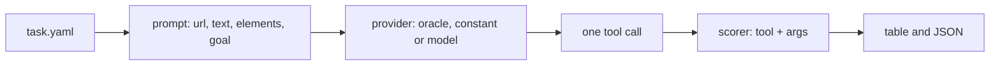

# agent-evals

Planner-level eval harness for tool-using agents. Tasks in YAML, one recorded page observation per task, any OpenAI-compatible model, one results table.


```bash
python -m harness --provider oracle
```

```text
| task | result | expected | actual |
| --- | --- | --- | --- |
| 01-navigate-docs | pass | click | click |
| 02-type-search | pass | type_text | type_text |
| ... | ... | ... | ... |

success 12/12 (100%)
```

## Why

Most agent repositories show one recorded run where everything worked. That is a demo, not evidence. This harness asks a narrower and more useful question:

> Given this page and this goal, does the model pick the right tool with the right arguments?

No browser, no network, no flaky sites. The planner is scored in isolation, so a failure points at the prompt or the tool schema, not at a random timeout.

## How it works



Each task is one step. The harness does not pretend to evaluate long horizons.

## Results in this repo

| Provider | Success | What it proves |
| --- | --- | --- |
| oracle | 12/12 | The harness and all task definitions are wired correctly |
| constant navigate | 0/12 | The scorer is not returning free passes |

The oracle is not a model. It returns the expected action and exists to test the harness. Real model numbers depend on your key, so run them yourself:

```bash
export LLM_API_KEY=sk-...
python -m harness --provider openai --model gpt-4.1-mini --out results/gpt-4.1-mini.json
```

The command writes JSON with a summary and per task verdicts.

## Task format

```yaml
id: 02-type-search
goal: search Wikipedia for Jeffrey Epstein
observation:
  url: https://en.wikipedia.org
  text: The Free Encyclopedia
  elements:
    - role: searchbox
      text: Search Wikipedia
    - role: link
      text: Main page
expected:
  tool: type_text
  args:
    text: Jeffrey Epstein
budget:
  steps: 1
```

The public set has 12 tasks across five tools: `navigate`, `click`, `type_text`, `scroll`, `finish`.

## Scoring

- The tool name must match exactly.
- Every key in `expected.args` must match after lowercasing and whitespace normalization.
- Extra keys in the actual call are ignored.
- One task, one verdict. No partial credit.

The rules are intentionally strict. A planner that clicks the right element but types the wrong email has not done the job.

## Quickstart

```bash
uv sync
uv run python -m harness --provider oracle
uv run pytest -q
```

Run against a real model:

```bash
uv run python -m harness \
  --provider openai \
  --model glm-4-flash \
  --base-url https://open.bigmodel.cn/api/paas/v4 \
  --api-key-env GLM_API_KEY \
  --out results/glm-4-flash.json
```

## Add a task

1. Copy any file in `tasks/`.
2. Write the observation exactly as an agent would see it: url, visible text, elements.
3. Set the expected tool and args.
4. Run `python -m harness --provider oracle` and confirm 100 percent.
5. Run `pytest -q`. The loader rejects duplicate ids, unknown tools and empty budgets.

## Design decisions

1. **No browser in the loop.** A benchmark that depends on live sites is not reproducible. Recorded observations make the same task run identically on CI and on a laptop.
2. **One action per task.** This isolates the planner from the executor. `browser-agent` owns the loop, this repo owns the decision quality.
3. **Oracle provider in CI.** The harness tests itself on every push without an API key and without spending tokens.
4. **Strict scoring.** Args are part of the action. A tool call with the wrong text is a failure, not a near miss.

## Limitations

- 12 tasks is a smoke test, not a leaderboard.
- Text observations only. No screenshots, no canvas.
- Single step. It cannot score multi step plans or recovery after an error.
- The `budget.steps` field is metadata for now, not enforced by the runner.

## Roadmap

See [open issues](https://github.com/Pinger1456/agent-evals/issues): multi step tasks, screenshot observations, cost tracking per run, a public results page.

## License

MIT
